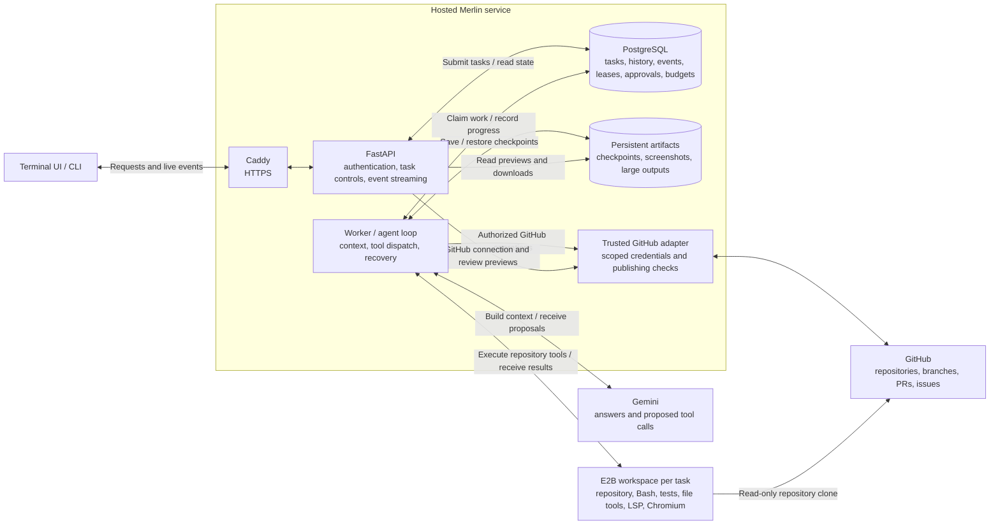
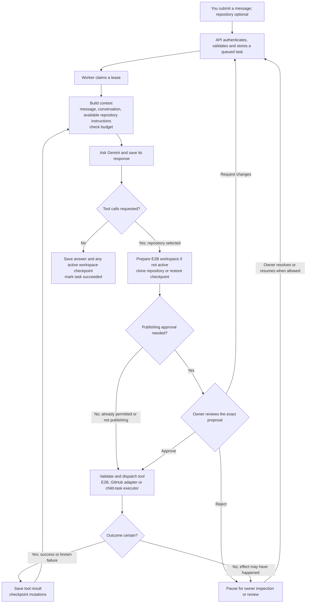

# Merlin architecture and task flow

These diagrams describe the current implementation. PostgreSQL is the production
store; local development can use SQLite. The database also holds the task queue.

## ASCII overview

```text
  You
   |
   v
Terminal UI / CLI  <--- persisted replies and progress ---+
   |                                                    |
   v                                                    |
FastAPI  <----------> PostgreSQL / SQLite <---------------+
                         | tasks, history, leases,
                         | approvals, budgets, events
                         v
                   Worker / agent loop
                         |
                         v
                      Gemini <-------------------------+
                         |                             |
                    Needs tools?                       |
                     /       \                         |
                   No         Yes (repository selected)|
                   |           |                       |
                   v           v                       |
              Chat reply  Create/restore E2B workspace  |
                   |           |                       |
                   |      Validate permissions         |
                   |        /              \           |
                   |       v                v          |
                   |   E2B tools       GitHub adapter   |
                   |   files, Bash,    scoped access,   |
                   |   LSP, browser    publishing review|
                   |        \              /           |
                   |         v            v            |
                   |       Save tool results ---------+
                   |       and coding checkpoints
                   v
          Store final reply and stream it to the terminal
```

The terminal can run locally while connecting to a local or hosted API. Ordinary
chat uses Gemini without creating an E2B workspace or accessing GitHub. Without a
selected repository, tools are omitted and unexpected tool calls are refused.

## Architecture



The API and worker are separate processes. The GitHub adapter and context/tool
components run within those processes. Repository commands execute inside E2B.
GitHub write credentials remain with the trusted adapter.

## How a task runs



1. **Submit:** the terminal sends an authenticated request. A submission ID prevents
   retries from creating duplicate tasks.
2. **Prepare:** the worker claims durable ownership and assembles conversational
   context. It starts an isolated workspace only when repository tools are requested.
   Coding follow-ups inherit the latest successful coding checkpoint, even after chat turns.
3. **Work:** Gemini receives the task context and proposes actions. Merlin checks
   permissions and executes the tools. Results return to Gemini for the next turn.
4. **Publish:** GitHub writes use task-scoped permission or explicit approval of
   the prepared operation. Repository text and model output cannot grant permission.
5. **Finish:** the final answer, events and any workspace checkpoint are stored. The API streams
   persisted progress to the terminal throughout the task.

Closing the terminal detaches; hosted work continues. Cancellation is an explicit
request that also stops child tasks. After a worker crash, a replacement claims
the expired lease and restores a checkpoint into a fresh workspace. Completed
operations reuse their saved results; uncertain mutations require inspection and
explicit resolution before work continues.

Optional child tasks receive separate E2B workspaces, share the parent's budget,
and cannot publish. The parent checks for file conflicts before integrating their
changes.

Implementation references: [composition root](../src/merlin/application.py),
[worker loop](../src/merlin/worker/__init__.py),
[durable store](../src/merlin/persistence/store.py), and
[tool authorization](../src/merlin/agent/__init__.py).
